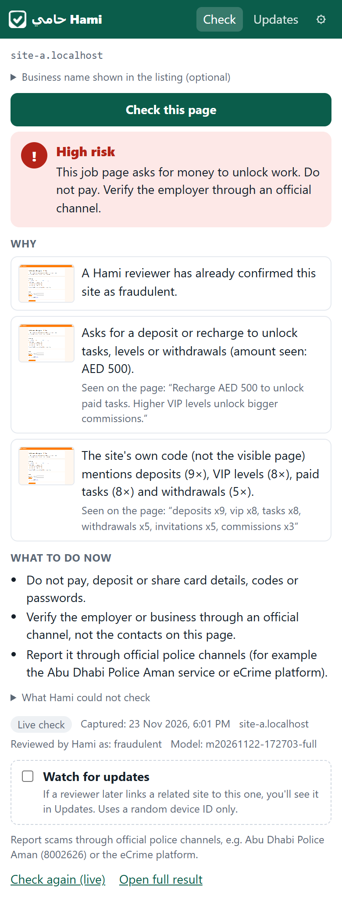
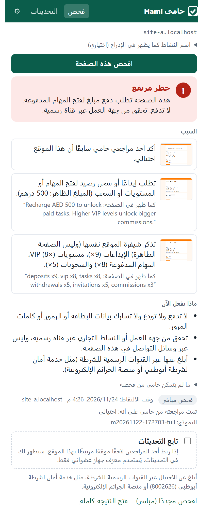
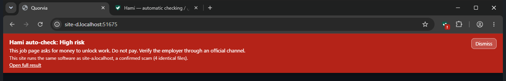
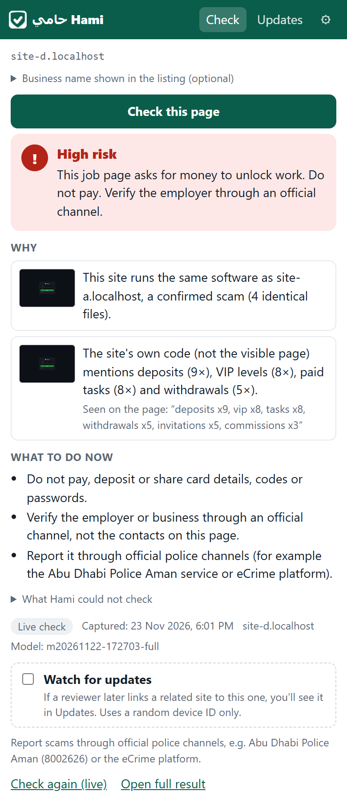
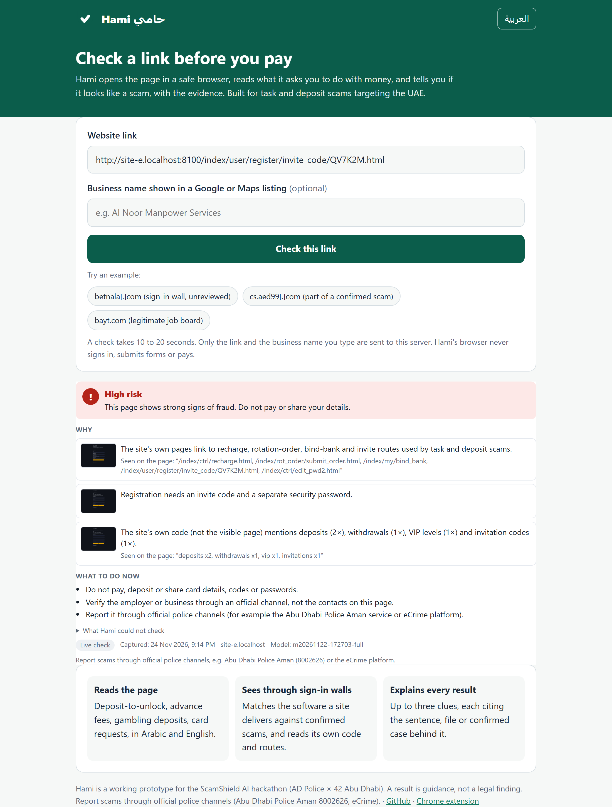

# Hami حامي

**Hami ("protector") warns people about fraudulent websites before they pay.** It is a Chrome extension backed by
an analysis server that runs on your own computer. It checks the page you are on, Google Search results and the
website behind a Google Maps listing. It answers in Arabic or English with a clear tier, the evidence behind it and
what to do next.

This is a working MVP for the AD Police × 42 Abu Dhabi **ScamShield AI** hackathon, not a mock-up. It captures and
scores real public pages, and the tests run real Chromium. The iOS and Android apps and a hosted server are on the
roadmap, not in this submission.

| | |
|---|---|
|  |  |
|  |  |

**Try it in a browser.** The public check page needs no install. Paste a link and get the same result card the
extension shows, in Arabic or English. While the team's server is running, it is at the address given in the
submission. Locally it is http://localhost:8000/. The reviewer console stays at `/review` behind its token.



**Quick start.** Install Docker and Chrome, then:

```bash
git clone https://github.com/mboausibah/hami.git && cd hami
docker compose up            # API + reviewer console on http://localhost:8000, discovery worker, trained model included
```

Then load the extension. Unzip [hami-extension.zip](https://github.com/mboausibah/hami/releases/latest/download/hami-extension.zip)
(or use `clients/extension/dist` from the clone), open `chrome://extensions`, turn on **Developer mode** and click
**Load unpacked**. Full instructions are in [part 3](#3-build-and-run).

---

## 1. Problem and solution

### The problem in the UAE

Scam contact is routine for UAE residents, and the money moves fast:
- A 2024 national survey by the UAE Cybersecurity Council and TRENDS Research & Advisory found that **56%** of respondents get a scam attempt at least once a month and **27%** had lost money (about **USD 2,194** on average).
- Nearly **half** of scams were completed within **24 hours** of first contact.
- Only **30%** of people report to law enforcement, and only **9%** of victims recovered their money in full (Gulf News).

Search results are part of the delivery route. In 2026 Abu Dhabi Police warned about fraudulent links and
misleading ads in search results, including fake recruitment sites (Gulf News). Dubai Police warned in October 2026
about part-time "jobs" that end in payments, and repeated that jobseekers should never pay to secure a job
(Khaleej Times). The sites change address often and disappear quickly (The National).

The hardest cases are **task and deposit scams**:
1. A message offers paid part-time work (rating products, completing "orders").
2. The victim registers on a portal and earns small commissions at first.
3. Then they must recharge to unlock higher VIP levels or larger tasks, and withdrawals stay blocked until more fees are paid.

Most of this happens **behind a sign-in wall**, so a URL checker or a scan of the public page sees almost nothing.
The domains are days old and get rebranded constantly, so blocklists are always behind.

### What Hami does

- **Reads what a page asks you to do with money**, in Arabic and English (deposit to unlock, advance fees, gambling deposits, investment promises, credential requests…), not just how the URL looks.
- **Sees through sign-in walls without signing in.** Scam portals are built from the same "kit". Hami fingerprints the files a site delivers (SHA-256, build-hashed names, near-identical similarity) and reads the strings inside its own JavaScript. A brand-new login page that runs the same software as a confirmed scam is flagged at once.
  - Example: aed99.com, betnala.com and betfugu.com share one build (26 identical files between aed99.com and betnala.com on a live scan).
  - A fresh install with no private data rates betnala.com and betfugu.com High through the seeded kit, and cs.aed99.com High through its confirmed domain.
- **Reads registration walls of families it has never seen.** The signals:
  - invite-gated sign-up and a separate "security password";
  - money-flow routes the site's own pages and lazy code chunks reference;
  - brand-bait logos;
  - throw-away domains, using the first certificate from certificate transparency.

  When a site blocks Hami's server with a bot challenge, the extension describes the page your browser shows (structure only, never what you typed).
- **Warns where the link is met.** The toolbar button and right-click menu check any page. Google Search results get shields. A Google Maps listing is checked against the website it points to, so a mismatch is flagged.
- **Checks automatically, with consent, without watching people.** An on-device pre-filter skips banks, government, health and well-known sites. Only likely scam pages are checked, and the badge and banner appear without a click.
- **Explains every decision.** Each result has a tier (High risk / Caution / No strong signals / Insufficient evidence), up to three clues with the sentence or file that triggered them, and what to do now.
- **Gives investigators leads, not guesses.** A reviewer console labels cases. Related sites are linked through shared files, infrastructure or registration destinations. A case brief exports with SHA-256 hashes and a clear split between observations and inferences. An optional investigator mode saves a sanitized `.har` from the browser.
- **Finds new domains first.** A discovery worker reads certificate-transparency logs for newly issued look-alike domains and captures them safely for review.
- **Gets better from each case.** Reviewed cases feed a versioned, calibrated classifier with a promotion rule. Confirmed cases ship as seed indicators, so a fresh install already recognizes known scam families.

---

## 2. Technical choices, trade-offs, and what we left out

### Choices and the reasoning behind them

| Choice | Why |
|---|---|
| **Rules decide the tier; the classifier confirms.** | A tier is a clear instruction, not a raw probability. High risk needs observed behavior and classifier agreement, or a reviewer-confirmed link. Weak signals (shared CDN, analytics, payment provider) never raise the tier alone. This keeps false alarms on real employers low. |
| **Calibrated logistic regression** on TF-IDF word 1–2 and char 3–5 grams plus structured indicators. | Trains in seconds, runs anywhere, is inspectable (the console shows the top-weighted phrases) and handles mixed Arabic/English. Char n-grams cope with Arabizi and spelling variation. A large model would add cost and opacity for little gain on this signal. |
| **Arabic normalization first.** | Alef variants, tatweel and diacritics are unified, and Arabic-Indic digits are mapped, so `٥٠٠ درهم` and `AED 500` give the same amount feature. |
| **Kit fingerprinting from delivered files.** | Sign-in walls hide the scam, but not the software. Matching uses SHA-256, Vite/webpack build-hashed names and bottom-k shingle sketches. A distinctiveness filter drops common libraries, files seen on legitimate sites or on 6+ sites, and files under 512 B. A strong match needs ≥3 distinctive files including an app chunk or language pack. |
| **Delivered code as its own evidence source.** | The app behind the login is described in its JS (the aed99 language pack mentions "withdraw" 38 times). Code mentions have their own thresholds and clues ("The site's own code (not the visible page) mentions…"), and payment gateways are excluded. |
| **Registrable-domain inheritance via the Public Suffix List** (private suffixes on). | `cs.aed99.com` inherits a confirmed `aed99.com`, but tenants of shared platforms (`*.github.io`, cloud storage buckets) stay separate. |
| **Capture once, analyze offline.** | Playwright Chromium in a fresh context, with time, request and size limits. Everything is sanitized and SHA-256 hashed before storage, so analysis is repeatable and a reviewer sees exactly what the model saw. Stored captures keep working after a scam site disappears. |
| **Kit-grouped evaluation.** | All variants of one scam kit stay in the same train/test split and CV fold, so scores are not inflated by near-duplicates. Thresholds are tuned out-of-fold (agree at ≤2% FPR, caution at ≤5%). |
| **Promotion rule + recorded manual override.** | A candidate replaces the current model only if recall does not drop and FPR does not rise. The live model was promoted by a reviewer, with the reason recorded: recall 0.21 → 0.83, FPR 0.003 → 0.022. |
| **Local-first backend, hosted one command away.** | Judges and users run everything locally with `docker compose up`. The same stack moves to PostgreSQL (`--profile postgres`) and to a VM with Caddy HTTPS (`--profile https`, [docs/DEPLOY.md](docs/DEPLOY.md)). All DB access goes through SQLAlchemy (`DATABASE_URL`), and artifacts go through a small storage interface. |

### Trade-offs we accepted

- **Recall vs. false alarms.** We tuned for few false alarms. The model alone misses about 17% of held-out scams. Rules and kit matching add coverage, but an unknown kit behind a sign-in wall usually gets Caution, not High.
- **On-device pre-filter.** It skips well-known and sensitive sites to protect privacy, so a scam hosted on a large platform won't be checked automatically (manual checks still work).
- **Local server.** Every user runs their own backend, which is private but means reviewer decisions are not shared between installs, apart from the shipped seed indicators.
- **SQLite by default.** It's simple for judges and moves to PostgreSQL with one command.

### What we left out

- **iOS and Android apps** with share-to-app from WhatsApp or Messages: designed, roadmap.
- **A hosted public server**: deployment is documented and tested locally with Caddy, but not deployed.
- **Push alerts**: watchers see updates in the extension when it syncs.
- **Screenshot OCR**: text inside images is not read.
- **An S3-compatible artifact store**: the interface exists, local storage only.

### With more time

1. iOS and Android apps (Expo) with the share sheet, reusing the same API and bilingual card.
2. A hosted service in UAE North with shared reviewer decisions and push alerts.
3. OCR for image-only scam pages and screenshots people forward.
4. More real labeled kits (gambling and investment especially), and Arabic legitimate look-alikes.
5. Intake from police reporting channels (e.g. Aman) and STIX export of indicators.

---

## 3. Build and run

### Option A: Docker (Windows, macOS, Linux)

```bash
docker compose up
```

The first build takes a few minutes. Nothing else is needed: no `.env` and no private data.
- **API and reviewer console:** http://localhost:8000 and http://localhost:8000/review.
- **Reviewer token** (generated on first start): `docker compose exec api python -m app.cli token`.
- **Model:** the committed trained model `m20261122-172703-full`.
- **Seed indicators:** the team's reviewer-confirmed cases (`data/seed/indicators.json`) load automatically. They are marked "seeded from team review" in the console.
- **PostgreSQL instead of SQLite:** `docker compose --profile postgres up` (see [docs/DEPLOY.md](docs/DEPLOY.md)).
- **Port:** the API listens on 127.0.0.1 only, on port 8000. Set `HAMI_PORT=8080` (for example) if 8000 is taken.
- **Public check page:** http://localhost:8000/. Paste a link, optionally add the business name from a listing, press Check. Public scans are limited per IP (`RATE_SCANS_PER_IP_PER_MIN`, default 8) and for the whole server (`RATE_SCANS_GLOBAL_PER_MIN`, default 40), so public testing cannot overload the capture browser.
- **A public HTTPS address from your own PC:** `cloudflared tunnel --url http://localhost:8000`. See [docs/DEPLOY.md](docs/DEPLOY.md#0-a-public-url-from-a-windows-pc-cloudflare-quick-tunnel).

### Option B: without Docker

Requires Python 3.11+ (and Node.js 20+ only to rebuild the extension). On Windows use `py tasks.py …` if `python` is not on PATH.

```bash
python tasks.py run          # creates .venv, installs deps + Playwright Chromium, starts http://localhost:8000
python tasks.py token        # reviewer-console token
python tasks.py help         # all tasks
```

### Load the Chrome extension

1. Download [hami-extension.zip](https://github.com/mboausibah/hami/releases/latest/download/hami-extension.zip) and unzip it. You can also use `clients/extension/dist` from the clone.
2. Open `chrome://extensions`, turn on **Developer mode** and click **Load unpacked**. Pick the folder.
3. A consent page opens (Arabic + English). Automatic checking starts only if you agree.
4. The extension talks to `http://localhost:8000` by default (**Options → Server URL**).

Try it:
- Click the Hami button on any page, or right-click a link → **Check this link with Hami**.
- Search Google for "part time job dubai" and turn on **Check search results** to see the shields.
- Open a Google Maps business and press **Check this business website**.

[docs/WALKTHROUGH.md](docs/WALKTHROUGH.md) runs Hami on real links in about five minutes.

### Train and evaluate

```bash
python tasks.py train-synthetic   # no private data needed: synthetic corpus -> dataset version + candidate + metrics
python tasks.py import            # with data/private: private labels + sessions + public datasets + synthetic
python tasks.py train             # kit-grouped split + 5-fold kit-grouped CV + tuned thresholds + promotion rule
python tasks.py eval-holdout      # false-alarm rate on legitimate pages not in training (captures public homepages)
python tasks.py promote <version> --reason "..." --reviewer <name>   # recorded manual override
```

### Tests and other tasks

```bash
python tasks.py check             # backend tests, end-to-end checks, extension type-check/lint/build, extension checks in Chromium
python tasks.py extension         # rebuild clients/extension/dist + hami-extension.zip
python tasks.py export-indicators # refresh data/seed/indicators.json from reviewed cases (indicators only)
python tasks.py screenshots       # regenerate docs/screenshots (fictional test sites)
python tasks.py release           # GitHub Release with the extension zip (needs the GitHub CLI)
python tasks.py migrate-to-postgres --to postgresql+psycopg://...   # copy SQLite data across and verify counts
```

`make <task>` works too, as a thin wrapper around `tasks.py`.

More documentation:
- [docs/TECHNICAL.md](docs/TECHNICAL.md): architecture, model and evaluation details.
- [docs/architecture.md](docs/architecture.md): modules and data flows.
- [docs/DEPLOY.md](docs/DEPLOY.md): server deployment.

---

## Results (real metrics)

Live model `m20261122-172703-full`, calibrated logistic regression, trained on private + sessions + public +
synthetic data.

| Evaluation | Precision | Recall | False-alarm rate (legit) |
|---|---|---|---|
| Held-out test set (684 pages, 457 kits) | **0.971** | **0.831** | **0.022** |
| 5-fold kit-grouped CV (2,478 pages, 1,860 kits) | **0.970** | **0.840** | **0.023** |
| Baseline: URL only (same test set) | 0.862 | 0.656 | 0.084 |
| Baseline: URL + page text | 0.974 | 0.749 | 0.016 |

Recall per scam type (kit-grouped CV):

| Scam type | Pages | Recall |
|---|---|---|
| Task scam | 66 | 0.91 |
| Phishing | 1,012 | 0.83 |
| Gambling deposit | 17 | 0.71 |
| Fake shop, investment, other | 12, 12, 30 | 1.00 |

Several types have small samples, mostly synthetic, so read those as directional.

Other results:
- **Unseen legitimate pages.** 50 UAE job boards, shops, gig and micro-task/survey platforms whose domains appear nowhere in training: **0 High, 0 Caution**. With 0/50 the 95% upper bound on the true false-alarm rate is about 6%. This is a small sample, not proof.
- **System level.** On 111 legitimate pages, rules, delivered code and kit matching produced 0 false alarms. All 11 pages of the confirmed aed99 family were High.
- **Brand-new scam sites (never trained, never reviewed): 1 of 1 flagged.** `python tasks.py eval-unseen` uses a private list of brand-new scam sites.
  - The first is a task-scam registration page that answers automated browsers with a Cloudflare challenge. It used to be rated "No strong signals"; from the server alone it is now **Caution**: invite code in the address, first certificate 87 days ago, random-looking .xyz name.
  - It is not High, because the money-flow routes and brand-bait logos of that kit appear only after login in the team's recording, and the domain is older than 30 days.
  - The list is small and will grow; read it as a test case, not a rate.
- **Legitimate sign-up and login pages: 0 High, 2 Caution of 31 loaded** (`python tasks.py eval-signup`).
  - The 38 pages cover UAE bank onboarding, telecoms, shops, delivery, job boards, gig and micro-task platforms, government, and 5 referral-code links. Some of these domains appear in training through their homepages; their sign-up pages do not.
  - All 5 referral links: neither High nor Caution.
  - The 2 Cautions (GulfTalent and LinkedIn sign-up) come from the page classifier, not the new registration-wall rules. The phishing training data makes login forms look risky.
  - 9 pages are "Insufficient evidence" (login walls, one bot challenge). 7 could not be loaded.
- **The 50 unseen legitimate pages, re-scored with the new rules: 0 High, 0 Caution of 51 loaded.** 9 are now "Insufficient evidence", mostly bot challenges that were previously misread as clean pages.
- **Where the model is weak.** Real sign-in-wall pages from our private sessions are caught by kit matching and domain inheritance, not by the text model (its recall on that small set is 0). That is why kit fingerprints exist.

These are prototype results on our data, not estimates of accuracy on the open internet.

---

## Privacy design

Principles:
- Hami protects people without watching them.
- The extension decides on the device what is worth checking.
- It sends the least that can answer the question, and only to the configured Hami backend.

**On the device, nothing is sent:**
- Local lists sync every 30 minutes: reviewer-confirmed hosts and registrable domains, recent CT domains, kit file names.
- A pre-filter classifies every page locally:
  - sensitive categories (banks, government, health, e-mail, …) are skipped;
  - well-known sites (Tranco top 10,000 + allowlist) are skipped;
  - every other page is a candidate; recent certificates and kit file names are noted as extra reasons.
- Confirmed sites show a red banner from the local list with no server call.

**Automatic checking (needs one-time consent):**
- A bilingual consent screen opens on install. Until the user agrees, nothing is checked automatically. It can be turned off in Options at any time.
- Only candidate pages are checked: at most 30 per hour, each host at most once every 6 hours.
- Every checked tab gets a colored toolbar badge. A full-page banner appears only for High risk.

**Page structure (with "Check this page" and with consented automatic checks):**
- Many scam sites show Hami's server a bot challenge instead of their page. Hami does not try to get past these. Instead, the extension describes the page your browser already shows. This is computed on the device from the page's HTML and inline scripts only; nothing is fetched, clicked or submitted.
- Sent with the URL:
  - same-site paths the page links to or mentions, without query strings;
  - image file names;
  - form-field descriptors (type, name, placeholder, label, required/read-only, and whether a non-password field arrived pre-filled);
  - the page title and visible text, with e-mails and phone numbers redacted.
- Never sent: what you typed, field values (for password fields not even whether they are filled), cookies, storage, query strings.
- Never collected on sites the pre-filter skips (banks, government, health, well-known sites).
- The server checks that the description belongs to the same site, keeps it as evidence, and never re-uses that result for anyone else's check.

**Idle snapshot (consent + Options toggle):**
- Taken after 10 seconds without activity on a candidate page, at most once per page load. Rate-limited per device on the server.
- The device sends metadata only: resource URLs with query strings and fragments removed, types, status codes, timings, sizes, and visible text with e-mails and phone numbers redacted.
- Never sent: cookies, headers, request or response bodies, local storage.
- The backend fetches the public JS/CSS itself without cookies, then stores a HAR-format artifact marked as metadata from the user's browser.

**Investigator mode (off by default, for reviewers):**
- Records a full HAR through `chrome.debugger`, only after the optional `debugger` + `downloads` permissions are granted. Chrome shows its "being debugged" bar while it records; Options explains this before it is turned on.
- The HAR is sanitized on the device by the same rules as the importer's strict mode:
  - removed: cookies, credential-like headers (checked by name and value), token-like query parameters, request bodies, WebSocket messages, sensitive JSON keys, e-mails, phone numbers;
  - authenticated non-static bodies are dropped.
- It is saved as a `.har` download after 10 seconds idle or on "Save evidence".
- It is uploaded only if "upload evidence" is also enabled. The server re-hashes the exact bytes, checks them against the device's SHA-256, sanitizes again, and stores both hashes.
- It never runs on sites the pre-filter skips.

**Other client data:**
- Search shields send result hostnames only, and only if enabled. No search queries and no browsing history are ever sent.
- Watches use a random device UUID. There are no accounts.

**Capture security:**
- The capture browser never signs in, submits forms, pays, downloads files, or follows discovered links.
- After the page has loaded, the capture may fetch extra code files the page's own scripts reference but did not request (lazy route chunks, language packs). The rules:
  - same site as the page it ended on;
  - only `.js` / `.mjs` / `.json` files (JSON only from static, asset or locale folders);
  - GET only, no redirects followed;
  - never HTML, never paths under `/api`, `/admin`, `/user`, `/account`, `/auth`, `/login`, `/pay`, `/order`;
  - at most 30 files and 10 MB per capture, 0.15 s apart, inside the capture's time limit.

  These files are sanitized and hashed like everything else, then read as delivered code and kit fingerprints.
- Domain age: the server asks public certificate-transparency services (Cert Spotter, crt.sh) when the domain's first certificate was issued. Answers are cached (7 days, 1 day after a failure) and queries are at least 2 s apart. Local and IP hosts are never looked up.
- Discovery is rate-limited. Discovered domains are review candidates and are never labeled fraudulent without a reviewer.

**Stored data:**
- Every artifact is sanitized, SHA-256 hashed and immutable.
- Reviews are append-only; a correction supersedes the earlier decision and keeps it visible.
- Observations are separated from inferences in the case brief.
- The static check stores the category and location of a suspected secret, never its value.

**Private data:**
- `data/private` and `data/processed` are never committed.
- Imported browsing sessions go through the strict sanitizer. Tokens are never replayed.
- The shipped seed file holds indicators only: domains, hostnames, kit IDs, file hashes and names, infrastructure hosts, labels, dates. It is validated against e-mails, phone numbers, tokens and paths.
- Test sites use fictional brands only.

## Extension permissions

| Permission | Why |
|---|---|
| `activeTab` | "Check this page" reads the URL of the tab the user clicked on. |
| `contextMenus` | "Check this link with Hami" on right-click. |
| `storage` | Settings, consent, local high-risk lists, device UUID. |
| `alarms` | Syncs the local lists every 30 minutes. |
| `scripting` | Shows the banner or result in the page the user asked about. |
| `webRequest` | Keeps a per-tab, in-memory list of resource URLs, types, status codes and timings for the idle snapshot. Only while automatic checking and snapshots are on. Never headers, cookies or bodies. |
| `http://*/*`, `https://*/*` | The on-device pre-filter and local banner must run on any page. Kit file names are matched against the page's resource names. Automatic checking works on sites nobody has reported yet. |
| Google Search / Maps content scripts | Search result shields and the Maps "Check this business website" button. |
| `debugger`, `downloads` (optional) | Requested only when investigator mode is turned on: full HAR recording and saving it as a `.har` file. |

## Acceptance checks

Results from `python tasks.py check` (83 backend tests, 33 end-to-end checks, 38 extension checks in real
Chromium), from a fresh clone, and from runs on real sites.

| Feature | Status | How it was verified |
|---|---|---|
| Fresh install from a clone | Pass | `docker compose up` from a fresh clone with no `data/private` and no `.env`. Healthy in under 2 minutes, committed model and seed indicators loaded, real scans work. `python tasks.py run` from a fresh clone created its own venv and served the API. |
| Scan a URL | Pass (local) | Real public URLs return tier, clues and hashed artifacts in 5–12 s on the local server. A hosted URL is documented, not deployed. |
| Warnings in Chrome | Pass | High risk on confirmed and same-kit sites, no warning on legitimate ones. Arabic RTL + English. |
| Warnings on phones / share to app | Roadmap | iOS and Android apps are not built. |
| Search and Maps | Pass | Shields on every result (red from the local list, hostname lookup for others). The Maps check flags a listing-name mismatch. |
| Discovery | Pass | A live run against Cert Spotter queued a newly issued matching certificate. The reviewer queue shows tiers. |
| Training on our data | Pass | `python tasks.py train` on private + sessions + public + synthetic data. Kit-grouped CV, versioned dataset and model, promotion rule applied, manual override recorded. |
| Evidence and review | Pass | Reviews are append-only with `supersedes`, enforced by database triggers on SQLite and Postgres. |
| Opt-in alert | Pass | A watcher gets the approved update with its reason, a non-watcher doesn't, withdrawn shows as withdrawn. |
| Linking and brief | Pass | The rebrand (Site B) joins Site A's cluster. A legitimate site sharing services (Site C) stays out. The brief exports with hashes and the observation/inference split. |
| Extension local list | Pass | After review and sync, the banner shows with no server call from the page. |
| Static check | Pass | The brief shows category and location, never the value. |
| Inconclusive cases | Pass | They never train the model or trigger alerts. |
| Sign-in wall, same kit | Pass | Site D (login wall) is High via a same-kit match with confirmed Site A. Live: betnala.com and betfugu.com are High on a fresh install through the seeded aed99 kit (26 and 13 identical files). |
| Registrable-domain inheritance | Pass | cs.aed99.com is High on a fresh install through the seeded aed99.com (live scan). The PSL keeps shared-hosting tenants apart. |
| Seed indicators | Pass | Loaded on first start, idempotent, marked "seeded from team review". Tested without private data or network. |
| Common libraries never match | Pass | A legitimate site with common libraries gets no kit match. 0 false alarms from rules, delivered code or kits on 111 legitimate pages. |
| Delivered code | Pass | The site's own JS strings are a separate source with their own clue. Payment gateways produce no code behaviors. |
| Automatic checking | Pass | Consent screen on install. Off before consent. A bank is skipped with nothing sent. A candidate gets a badge without a click. A banner appears only for High. The extension check runs the shipped build without optional permissions. |
| Idle snapshot | Pass | Sent after 10 s idle. Stored as a metadata HAR artifact with SHA-256. Kit match with Site A. No query strings, cookies or e-mails stored. |
| Investigator mode | Pass | Refused on a bank. Auto-saved after 10 s idle. The `.har` contains none of the planted cookie or token values. The SHA-256 matches, and the upload is verified server-side. |
| False alarms on unseen legitimate pages | Pass | 0/50 (0 High, 0 Caution) on job boards, shops, gig and micro-task platforms not in training. The 95% upper bound is about 6%. |
| Public check page | Pass | `GET /` serves a bilingual page with the extension's result card. On a fresh `docker compose up`, betnala.com and cs.aed99.com come back High and bayt.com "No strong signals". The same works through a Cloudflare quick tunnel. `/review` still requires the token. |
| Signature pair | Pass | An invite gate plus a separate security/fund password field on one registration page is High on its own. Legitimate hold-outs re-scored: 38 sign-up pages 0 High (2 Caution from the page classifier), 50 pages 0 High / 0 Caution. |
| Same answer on every check | Pass | Page and URL signals decide immediately. The certificate-age lookup runs in the background and shows as "not yet known" until it returns. Results scored with older rules, or with the lookup pending, are re-scored from the stored capture. The automatic check and "Check this page" give the same tier for the same URL (extension check). |
| Unseen scam family behind a bot challenge | Pass (Caution) | The registration page that was rated "No strong signals" is now Caution from the server alone: bot challenge recognized, invite code in the address, first certificate 87 days ago, random .xyz name. With the extension, the page structure from the user's browser is added (fictional site-f test: High). |
| Registration walls, routes, chunks | Pass | Fictional site-e (invite-gated wall with a security password; task routes only in a lazy JS chunk the page never loads) is High with no reviewed case. A login wall with nothing else is never "No strong signals". |
| Legitimate sign-up pages | 0 High | 31 loaded: 0 High, 2 Caution (page classifier, not the wall rules), 9 Insufficient evidence. All 5 referral-code links: neither High nor Caution. |
| Gateways and template reuse | Pass | A `/code/<invite>` page that meta-refreshes to `/register/invite_code/<same code>` on another domain yields a strong pending "redirect / invitation gateway" link. Both domains become review candidates and are watched by the discovery worker. A second brand reusing a registration template gets a medium "same page template" link (template reuse, not common ownership). Both appear in the case brief. |
| PostgreSQL | Pass | All backend tests and e2e checks pass on PostgreSQL 16. `docker compose --profile postgres` switches automatically. `migrate-to-postgres` copied 314 scans and 20,600 observations with all counts verified. |

## Data sources and licenses

Public datasets are downloaded locally and never committed.

| Dataset | License | Citation | Use |
|---|---|---|---|
| Fraudulent and Legitimate Online Shops Dataset (1,140 URLs) | CC BY 4.0 | Janaviciute, A., Liutkevicius, A. (2023). Mendeley Data, V1, doi:10.17632/m7xtkx7g5m.1 | URL-only records for the URL baseline. The shops are not captured. |
| Phishing Website Dataset (10,395 sites) | CC BY 4.0 | Putra, I. K. A. A. (2023). Zenodo, doi:10.5281/zenodo.8041387 | Balanced sample of 1,000 phishing + 1,000 legitimate pages with ≥25 words of visible text. |
| Tranco top sites list | No license stated by Tranco. Upstream: CrUX (CC BY-SA 4.0), Cloudflare Radar (CC BY-NC 4.0), Majestic (CC BY 3.0), Cisco Umbrella. **Non-commercial use only.** | Le Pochat, V. et al. (2019). Tranco: A Research-Oriented Top Sites Ranking Hardened Against Manipulation. NDSS 2019. https://tranco-list.eu | Legitimate domains for the URL baseline (top 2,000). The extension's on-device skip list (top 10,000). Rank is not proof of safety. |

PhishTank was not used because it requires an application key. Private data (labeled URLs, legitimate captures and
the team's own browsing sessions) stays in `data/private/`.

Main open-source components:
- FastAPI and SQLAlchemy (MIT).
- Playwright (Apache-2.0).
- scikit-learn (BSD-3-Clause).
- BeautifulSoup (MIT) and lxml (BSD).
- tldextract (BSD-3-Clause) and RapidFuzz (MIT).
- psycopg (LGPL-3.0).
- Vite (MIT) and TypeScript (Apache-2.0).
- PostgreSQL (PostgreSQL License) and Caddy (Apache-2.0).

## Known limitations

- Chrome extension + local server only. iOS/Android apps and a hosted server are roadmap. Reviewer decisions are not shared between installs, apart from the shipped seed indicators.
- The live model was promoted manually. The automatic rule would have kept the synthetic model, because held-out FPR rose from 0.003 to 0.022 while recall rose from 0.21 to 0.83. The override and its reason are recorded.
- Kit matching needs at least one confirmed site in the family. An entirely new kit behind a sign-in wall reaches High only if the classifier agrees on its delivered code; otherwise Caution.
- Sites that hide content from automated browsers (cloaking) or block them with a bot challenge get "Insufficient evidence" from the server, never "safe". Hami does not try to get past bot checks. The page structure the extension sends from the user's own browser is what fills that gap, so a server-only check of such a site sees less.
- Scam kits that reveal their money-flow routes only after login look like ordinary sign-up walls to a visitor who has not registered. Hami then relies on the invite gate, the domain age and the address (Caution, not High).
- The page classifier tends to score legitimate sign-up forms as risky, because login forms dominate the phishing training data. It produced 2 Cautions on 31 legitimate sign-up pages; the registration-wall rules produced none.
- `STORAGE_URL=s3://…` is designed (`ArtifactStore`) but not implemented.
- The Tranco-based skip list is for non-commercial use.

## Team and credits

The team is listed in [docs/team.txt](docs/team.txt). Hami grew out of the team's own fraud investigations of scams
targeting the UAE.

Development used [Claude Code](https://claude.com/claude-code) (Anthropic) as a coding assistant.
